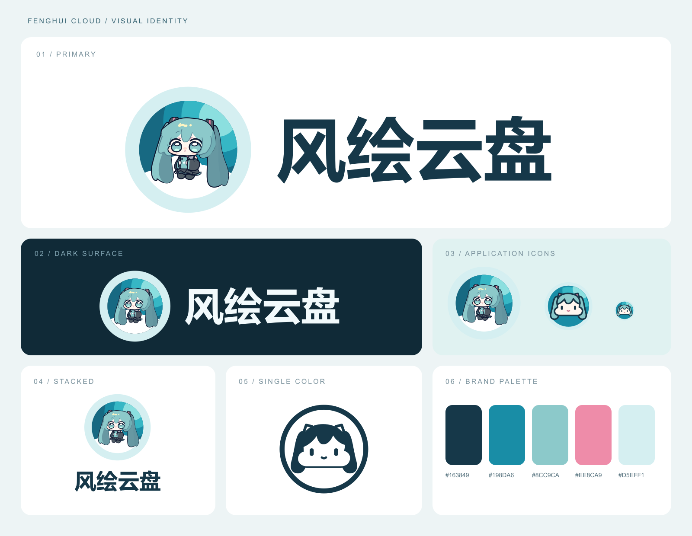
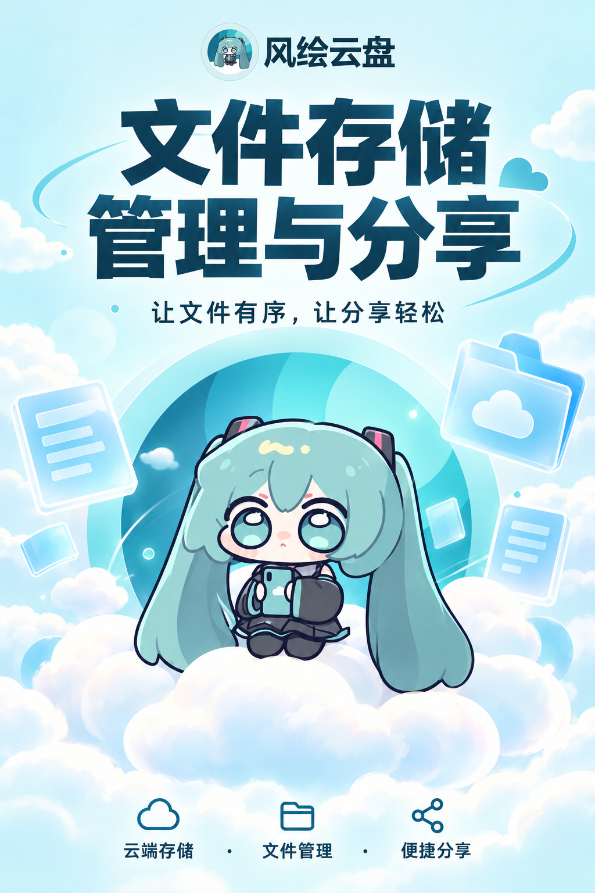

<p align="center">
  
</p>

<h1 align="center">风绘云盘 · 品牌素材库</h1>

<p align="center">
  以青绿色双马尾角色与云朵为视觉核心，整理 Logo、站点图标和宣传素材。
</p>

<p align="center">
  <code>SVG · PNG · ICO</code>&nbsp;&nbsp;
  <code>透明背景</code>&nbsp;&nbsp;
  <code>16–1024 px</code>
</p>

<p align="center">
  <a href="#preview">视觉预览</a>&nbsp; · &nbsp;
  <a href="#cloudrave">Cloudrave 资源</a>&nbsp; · &nbsp;
  <a href="#assets">素材索引</a>&nbsp; · &nbsp;
  <a href="#build">构建与打包</a>&nbsp; · &nbsp;
  <a href="https://github.com/HuiDevCom/pan-icon/archive/refs/heads/main.zip">下载项目</a>
</p>

---

<a id="preview"></a>

## 视觉预览



<p align="center">
  <a href="logo/preview/brand-preview.svg">矢量总览</a>&nbsp; · &nbsp;
  <a href="logo/preview/logo-comparison.png">横版对照</a>&nbsp; · &nbsp;
  <a href="logo/README.md">完整使用说明</a>
</p>

<a id="cloudrave"></a>

## 直接用于 Cloudrave

**[打开新版替换资源 →](logo/cloudrave/)**

五个文件沿用原件命名，方便按实际部署路径对应替换。

| 文件 | 格式与尺寸 | 用途 |
| :--- | :--- | :--- |
| [logo.svg](logo/cloudrave/logo.svg) | SVG · 透明背景 | 浅色背景使用，深色文字 |
| [logo_light.svg](logo/cloudrave/logo_light.svg) | SVG · 透明背景 | 深色背景使用，浅色文字 |
| [logo192.png](logo/cloudrave/logo192.png) | PNG · 192 × 192 | 完整角色图标 |
| [logo512.png](logo/cloudrave/logo512.png) | PNG · 512 × 512 | 高清完整角色图标 |
| [favicon.ico](logo/cloudrave/favicon.ico) | ICO · 16–256 px | 浏览器标签页简化图标 |

> 新版资源位于 **`logo/cloudrave/`**。根目录的 `cloudrave/` 保留原件，供核对与还原使用。

<a id="assets"></a>

## 素材索引

| 想要使用 | 资源入口 | 说明 |
| :--- | :--- | :--- |
| 横版 Logo | [深色文字](logo/logo.svg) · [浅色文字](logo/logo_light.svg) | 两套透明底版本，共用同一枚彩色图标 |
| 竖版与单色 Logo | [variants/](logo/variants/) | 竖版、纯文字与单色印刷版本 |
| 角色与网站图标 | [icons/](logo/icons/) · [favicon.svg](logo/favicon.svg) | 完整角色、简化玩偶、Apple Touch 图标 |
| PNG 导出 | [png/](logo/png/) | 多尺寸图标、Logo 的 1× / 2× 导出 |
| 宣传海报 | [海报原图](poster/fenghui-cloud-poster.png) · [生成提示词](poster/generation-prompt.txt) | 1024 × 1536 竖版海报 |
| README 动态封面 | [readme-cover.svg](assets/readme-cover.svg) | 角色浮动与每 6 秒一次的眨眼动画 |
| 原始素材 | [originals/](assets/originals/) | 原始 Cloudrave 资源与 miku.svg |

<details>
<summary><strong>展开宣传海报预览</strong></summary>

<p align="center">
  <a href="poster/fenghui-cloud-poster.png">
    
  </a>
</p>

</details>

<a id="build"></a>

## 构建与打包

需要 **Node.js ≥ 20.9.0** 和 **Python 3**。在项目根目录依次执行：

```bash
npm ci
npm run build
npm run package
```

| 步骤 | 结果 |
| :--- | :--- |
| `npm ci` | 安装锁定版本的 Sharp 依赖 |
| `npm run build` | 生成 Logo、图标、预览图和 README 动态封面 |
| `npm run package` | 同步五个 Cloudrave 替换文件，并生成全套 ZIP |

交付包生成于 `deliverables/fenghui-cloud-logo-kit.zip`。该目录不提交 Git；下载项目后可以本地重建。

打包命令需要可用的 `python` 命令，也可以直接用 Python 3 执行 `logo/source/package.py`。修改中文字形时才需要运行 Windows 下的 `build-wordmark.ps1`；日常构建直接使用已有字形轮廓。

<details>
<summary><strong>项目结构</strong></summary>

```text
pan icon/
├─ assets/
│  ├─ originals/       原始素材
│  └─ readme-cover.svg 动态封面
├─ cloudrave/          原件副本
├─ logo/
│  ├─ cloudrave/       可直接使用的新版资源
│  ├─ icons/           完整角色、简化与单色图标
│  ├─ variants/        竖版、单色与纯文字 Logo
│  ├─ png/             多尺寸透明 PNG
│  ├─ preview/         总览、对照图与 HTML 预览页
│  └─ source/          生成脚本、字形与源数据
├─ poster/             海报与生成提示词
├─ deliverables/       本地生成的交付包
└─ archive/            本地历史归档
```

</details>

<details>
<summary><strong>设计与维护说明</strong></summary>

- 中文名称使用矢量轮廓；实际 Logo 的 SVG 与 PNG 均为透明背景。
- 彩色图标共用一套，Logo 通过文字颜色适配深浅背景；另保留单色印刷版本。
- 完整角色坐于云层中部并略向左调整，简化玩偶居中且不保留底部云朵。
- 动态封面为直角矩形，使用自包含 SVG 与 CSS 动画，支持减少动态效果设置，无外部图片或脚本依赖。
- HTML 尺寸预览页位于 `logo/preview/preview.html`，下载项目后在浏览器本地打开。
- 协作约定见 [AGENTS.md](AGENTS.md)，忽略规则见 [.gitignore](.gitignore)。源素材与成品保留在版本管理中，交付包、历史归档、依赖和缓存保留在本地。

</details>

---

<p align="center">
  <sub>风绘云盘 · 品牌素材与视觉资源</sub><br />
  <a href="https://github.com/HuiDevCom/pan-icon">仓库首页</a>&nbsp; · &nbsp;
  <a href="logo/README.md">使用说明</a>&nbsp; · &nbsp;
  <a href="#preview">返回预览 ↑</a>
</p>
